# Indexing a Ternary Plot

***"Abstract"***: **The aim is to put one sortable number on a point that lives in a ternary plot, discern what you give up when you do, and compare to the classic ternary plot and version of it. The conclusion is, despite multiple attempts at options that identify one specific point within a desired module in the plot, a version of the classic ternary triplet (or a mix that reduces the reading to a vector) remains a preferable choice for identifying unique points in the plot. To better visualize this idea, which can be hard especially for visual learners, a demo plot is created in Python that allows the user to scale along the plot using each method to track the differences in values that occur when "nudges" or perturbations to the system induce a change of index value.**

This repository contains:

- a small Python library (`ternary_index/`) that implements every approach tried along the way of diagnosing the best indexing option,
- an **interactive explorer** (`demo.py`) where you can switch between approaches, click index cells, move a point around and watch what each index does,
- a scorecard that measures every approach against the same requirements,
- the approach that came out on top, implemented twice: once in Python and once as a dependency-free **C# class for Unity** (`unity/TernaryState.cs`), with a test proving both give identical numbers,
- every figure in this README, regenerated by one script.

Nothing here is tied to a particular application, it remains general use, although the creator uses this for an ethical system scale in a video game. There may be many other valid applications, and so the three corners/vertices are just left as **A**, **B** and **C**. Plug in whatever your three quantities are.

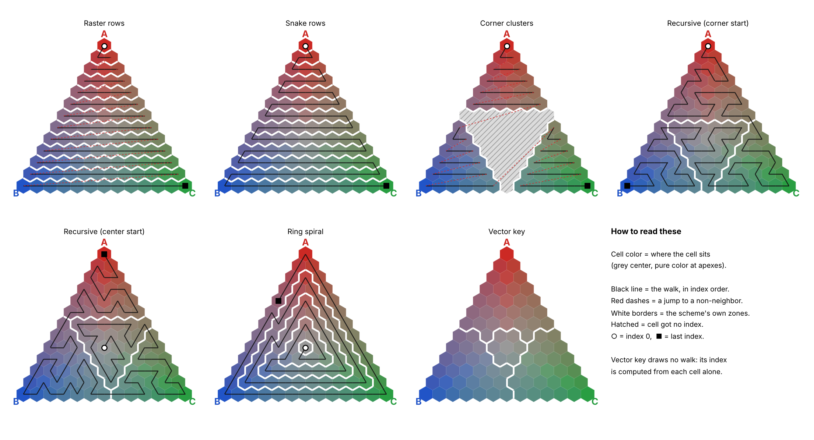

---

## TLDR

1. A ternary plot is a bound triangular plane (or ~triangle~) that shows three shares that always add up to 100 % (vertices representing 100% that value for the 3 points that lie on one of them). Every point in the triangle is one such mix.
2. People often want (and turns out have taken great steps toward achieving) a **single number** identified at a point: to sort by, to key a lookup table on, to drive a progression. Turning a 2-D triangle into a 1-D number is the ultimate problem.
3. The intuitive desire for the number to be **continuous** (next number in the sequence = neighboring point/cell) and **grouped by corner** (numbers near each other belong to the same vertex region) leads naturally to space-filling curves. A recursive, fractal walk through the triangle achieves both. This is something similar to the "Triforce" in The Legend of Zelda, or the famous "Sierpinski gasket" in shape.
4. But a walk can only follow **one** thing smoothly. Every point has two independent properties: its **direction** (which corner it leans toward) and its **magnitude** (how far from the center it is). Any single walk scrambles at least one of them in this system.
5. The better design is to merely slightly alter the traditional reading of the ternary plot value to meet the specific demands of the system. I.e. store the point itself (the three shares) and **derive** what you need from it on demand: the **camp** (which corner region it is in), the **magnitude**, the lean toward a neighbor, and a single integer or **key** would be of the form `camp × 100 + intensity`. That key keeps same-camp values together *and* rises with distance from the center, which no walk can do. For those with experience in polar coordinates, this system is analogous to that coordinate system with camp as the angle sector, intensity as the radius, and the neutral zone as the pole. It is disanalogous in that the angle is only three coarse wedges plus a lean, not a continuous θ, and the triangle’s edge cuts off the “circle”, so the radius stops at the rim instead of running to infinity.
6. In perturbations to the system, points move by being pulled toward targets (`w ← w + α(target − w)`), with a step size `α` that shrinks over time and never leaves the triangle. Each new input moves it less than the last, because it is weighed against a growing history as a running tally of inputs, so the point always equals the average of everything applied so far. Pulling toward the center is just another target, with no special handling.

---

## Contents

1. [The problem](#1-the-problem)
2. [Vocabulary](#2-vocabulary)
3. [Quick start](#3-quick-start)
4. [The interactive explorer](#4-the-interactive-explorer)
5. [What we want from an index](#5-what-we-want-from-an-index)
6. [The journey, one scheme at a time](#6-the-journey-one-scheme-at-a-time)
   - [6.1 Raster rows](#61-raster-rows-reading-it-like-a-book)
   - [6.2 Snake rows](#62-snake-rows-fixing-the-line-break-jump)
   - [6.3 Corner clusters](#63-corner-clusters-grouping-by-corner-the-direct-way)
   - [6.4 Interlude: why no index can ever be perfect](#64-interlude-why-no-index-can-ever-be-perfect)
   - [6.5 Interlude: the shape of the cells matters](#65-interlude-the-shape-of-the-cells-matters)
   - [6.6 Recursive walk from a corner](#66-recursive-fractal-walk-starting-at-a-corner)
   - [6.7 Recursive walk from the center](#67-recursive-fractal-walk-starting-at-the-center)
   - [6.8 Ring spiral](#68-ring-spiral)
   - [6.9 The real conflict: direction versus magnitude](#69-the-real-conflict-direction-versus-magnitude)
7. [The resolution: store the point, derive the index](#7-the-resolution-store-the-point-derive-the-index)
8. [Moving the point: the update rule](#8-moving-the-point-the-update-rule)
9. [The scorecard](#9-the-scorecard)
10. [Further reading](#14-further-reading)

---

## 1. The problem

A **ternary plot** (also called a triangle plot or simplex plot) displays three non-negative quantities that always add up to a fixed total, usually 1 or 100 %. Because the third share is always determined by the other two, every mix fits on a flat triangle:

- each **corner** (apex) is 100 % of one quantity and 0 % of the other two,
- each **edge** is a mix of only two quantities (the third is 0 %),
- the **center** (centroid) is an even ⅓ / ⅓ / ⅓ split,
- every point in between is some unique mix.

Ternary plots show up wherever three things compete for a fixed whole: the sand / silt / clay makeup of soil, the three components of an alloy, red / green / blue weights in a color, how a budget is split between three departments, three-party vote shares, or three play-styles in a game.

Very often you end up wanting **one number** per point:

- to **sort** points,
- to use as a **key** into a lookup table ("at this mix, show this content"),
- to describe **progress** ("how far along is this point?"),
- to store compactly.

The trouble is that a triangle is two-dimensional and a number line is one-dimensional. This repository is a careful, measured exploration of some common, reasonable ways to bridge that gap, and of why the best answer turns out to be a weighting of 2 more essential components that identify a point.

---

## 2. Vocabulary

| Term | Usage in this repo |
|---|---|
| **Triplet**, **w** | The three shares `(A, B, C)` of a point, as fractions that add up to 1. Also called barycentric coordinates. |
| **Apex** / corner | One of the three pure points `(1,0,0)`, `(0,1,0)`, `(0,0,1)` or vertices of the triangle. |
| **Centroid** / center | The even mix `(⅓, ⅓, ⅓)`. |
| **Edge midpoint** | A 50/50 mix of two quantities with none of the third, halfway down an edge, e.g. `(½, ½, 0)`. |
| **Resolution n** | How finely the triangle is chopped up. Only triplets that are whole multiples of `1/n` are kept. |
| **Lattice** / grid | The set of all such triplets `(a, b, c)` with whole numbers `a + b + c = n`. There are `(n+1)(n+2)/2` of them (proof below). |
| **Cell** | One lattice point, drawn as a small hexagon around it. |
| **Neighbors** | Two cells whose hexagons share an edge. Equivalently, you can move one unit from one share to another: `(a, b, c) → (a+1, b−1, c)` and the other five directions. Interior cells have 6 neighbors, edge cells 4, corner cells 2. |
| **Index** | A number assigned to each cell by some **scheme**. |
| **Walk** (path) | A scheme where the index orders the cells in a sequence meant to step from neighbor to neighbor, like a pen tracing through the grid without lifting. |
| **Jump** | A step in a walk between two cells that are *not* neighbors. |
| **Tear** | Two neighboring cells whose indices are far apart. |
| **Zone** | A scheme's own top-level regions (its rows, rings, quadrants...). |
| **Camp** | The region a point belongs to in the final design: a small **neutral** disc around the center, plus three **kites**, one per corner. A point is in corner X's kite if X is its largest share. |
| **Kite** | The four-sided region where one share is the largest. Its borders are the straight lines from the centroid to the edge midpoints. |
| **Magnitude ρ** | Straight-line distance from the centroid, scaled so each apex is exactly 1. |
| **Edge intensity r** | An alternative distance measure that is 1 everywhere on the outer edge. |
| **Lean** | How far a point tilts away from its own apex toward a neighboring corner. 0 means straight at the apex, 1 means on the border with the neighbor's kite. |
| **Key** | The final single-integer index: `camp × 100 + floor(100 × intensity)`. |
| **Agent** | A point that moves around the triangle in response to "actions" (in the demo and in `TernaryState`). |

---

## 3. Quick start

Requires Python 3.9+ with NumPy and Matplotlib.

```bash
pip install -r requirements.txt

python demo.py              # the interactive explorer (needs a desktop window)
python demo.py -n 18        # start at a different grid resolution

python -m pytest            # run the test suite
python scripts/render_figures.py   # regenerate every image in figures/
```

The demo needs Matplotlib's interactive window support (TkAgg, QtAgg or MacOSX backends; the default install on most desktops already has one). On a headless machine the figures script still works.

The C# class needs nothing but a C# compiler. See [10.3](#103-c-and-unity).

---

## 4. The interactive explorer

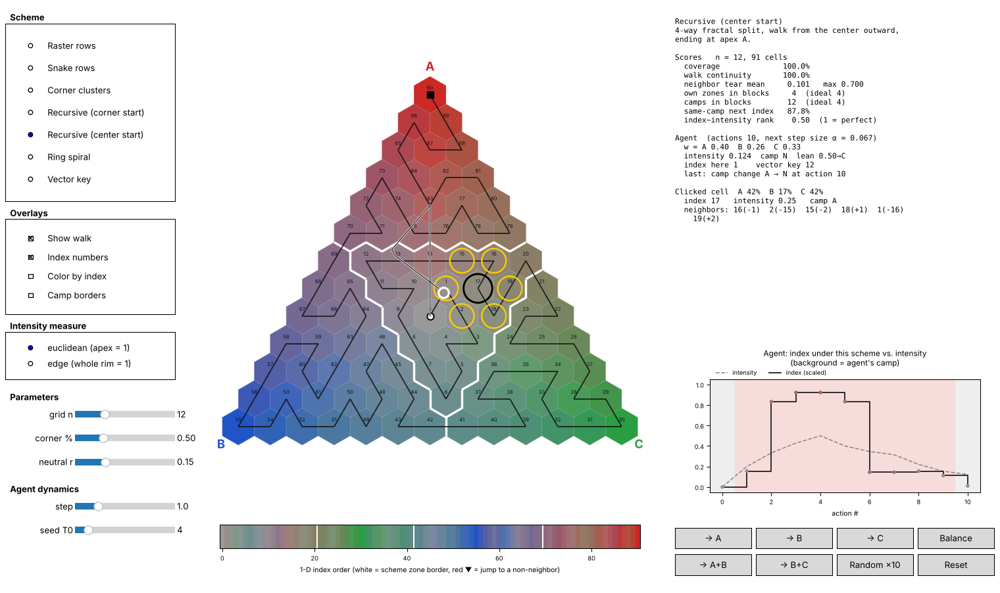

The window has three columns.

**Left: controls**

| Control | What it does |
|---|---|
| **Scheme** | Switch between the seven indexing schemes described in [section 6](#6-the-journey-one-scheme-at-a-time). |
| **Show walk** | Draw the walk: a black line through cells in index order. Red dashes mark jumps to non-neighbors. ○ marks index 0, ■ marks the last index. |
| **Index numbers** | Print each cell's index on it (hidden automatically for very large grids). |
| **Color by index** | Recolor cells from dark (low index) to bright (high index) instead of by position. Makes the shape of the ordering obvious at a glance. |
| **Camp borders** | Overlay dashed black lines around the neutral disc and the three kites, the regions the scorecard measures against. |
| **Intensity measure** | Choose Euclidean magnitude (only apexes reach 1) or edge intensity (the whole rim reaches 1). Affects colors, camps, the vector key and the agent. |
| **grid n** | Resolution of the grid, 2 to 36. |
| **corner %** | Threshold for the *Corner clusters* scheme. |
| **neutral r** | Radius of the neutral camp, measured in the chosen intensity. |
| **step**, **seed T0** | The two knobs of the agent's update rule ([section 8](#8-moving-the-point-the-update-rule)). |

**Middle: the triangle and the index line**

The big triangle shows every cell. Cells are colored by position (grey at the center, fading out to pure red, blue and green at the apexes A, B, C). Thick white borders show the current scheme's own zones; hatched cells received no index.

The strip underneath is the **1-D index line**: every indexed cell's color, laid out left to right in index order. This is what the number line "looks like". White ticks mark zone boundaries and small red ▼ marks show where the walk jumps. A scheme that groups by corner shows long runs of one hue; a scheme that does not shows a rainbow.

**Right: scores, inspector and agent**

- **Scores** for the current scheme (definitions in [section 9](#9-the-scorecard)).
- **Agent**: a point that starts at the center. The buttons pull it toward A, B, C, toward a 50/50 mix of two corners, back toward the center (**Balance**), or apply ten random actions. Its trail is drawn on the triangle, and the panel shows its shares, camp, lean, the index it currently sits on under the selected scheme, and its vector key. Camp changes are reported.
- **History plot**: as the agent moves, this plots the scheme's index at the agent's position (solid) against the agent's distance from the center (dashed), with the background tinted by the agent's camp. This is the single most revealing view in the tool: a good index should change *gently and meaningfully* when the point moves gently. For the vector key, the solid line shows the key's last two digits (the intensity level) and the tint shows its hundreds digit (the camp).
- **Clicked cell**: click any cell to see its shares, index, intensity, camp, and each neighbor's index with the difference (Δ). Large Δ values are tears.

**Keyboard shortcuts:** `a` / `b` / `c` push the agent toward a corner, `n` balances, `space` runs ten random actions, `r` resets.

### (Things to try)

1. **Raster rows** with *Color by index* on. The colors run in horizontal stripes, and the red dashes show the jump at the end of every row.
2. **Recursive (center start)**: click a cell next to a white zone border and read the neighbor list. One neighbor will be dozens or hundreds of indices away.
3. **Corner clusters**: drag *corner %* upward and watch the unindexed hole in the middle grow. Those are exactly the balanced mixes.
4. **Ring spiral**: press *→ A* a few times, then *→ B* a few times. The agent's camp flips, but the index barely notices. The ring spiral tracks distance from the center and ignores direction.
5. **Vector key**: switch the *Intensity measure*. Watch the numbers on cells near the edge midpoints change: Euclidean calls them half-way out, edge intensity calls them all the way out.
6. Any scheme: set *seed T0* to 0 and press *→ A* once: the agent jumps straight to the apex. Set it to 30: the agent barely moves. That is the inertia knob.
7. Drag *grid n* between odd and even values on a recursive scheme. The zone shapes change slightly because odd and even sizes are cut differently ([6.6](#66-recursive-fractal-walk-starting-at-a-corner)), but the walk always stays unbroken.
8. Press *Random ×10* a few times on each scheme in turn and compare the history plots.

---

## 5. What we want from an index

Before comparing schemes, it helps to state the wishes precisely. These are the properties every scheme is scored on.

| # | Requirement | Plain-language version |
|---|---|---|
| **R1** | **Coverage** | Every cell gets an index. No mix is left without a number. |
| **R2** | **Continuity** | Consecutive indices are neighboring cells. Counting up by one never teleports you across the triangle. |
| **R3** | **Grouping by corner** | All cells of one camp occupy one unbroken block of indices. Numbers near each other mean "the same kind of mix". |
| **R4** | **Magnitude tracking** | Within a camp, a higher index means further from the center. The number reads as "how strongly this point leans into its corner". |
| **R5** | **Neutral origin** | Index 0 is the center, the balanced starting point. |
| **R6** | **Stability** | When a point moves a little, its index changes a little, and in a way that means something. |

R1 and R2 are about the walk. R3 and R4 are about what the number indicates. R5 and R6 matter whenever the index describes something that moves over time. As the journey shows, R2, R3 and R4 cannot all be satisfied at once by any walk; that conflict is the heart of the story.

---

## 6. The journies (methods)

Every scheme below is implemented in [`ternary_index/schemes.py`](ternary_index/schemes.py), is selectable in the demo, and is scored in [section 9](#9-the-scorecard). All figures use `n = 12` (91 cells).

### 6.1 Raster rows

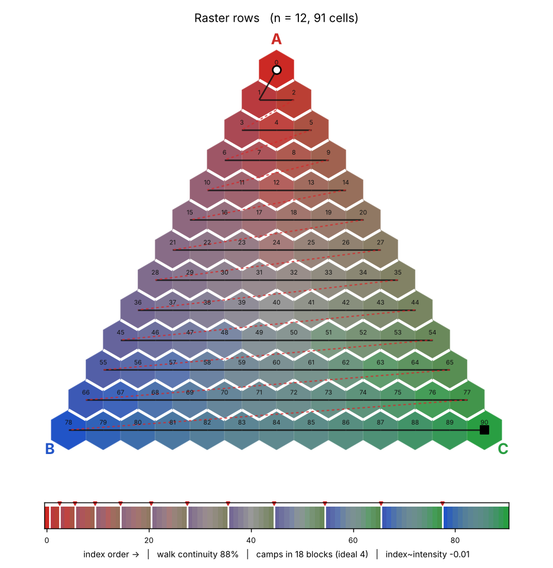

**Idea**: Number the cells the way you read a page: start at apex A, go along each row from left to right, then drop to the next row and start again at its left end.Rows are lines of constant A share. Within a row, B decreases and C increases from left to right.

**Pros**
- Full coverage (R1).
- Horizontal neighbors get consecutive numbers.
- Its *worst* tear is the smallest of every scheme that indexes all cells: about one row's length. For any 2-D grid, a tear of roughly that size somewhere is unavoidable (see [6.4](#64-interlude-why-no-index-can-ever-be-perfect)), so in that narrow sense rows are already near-optimal.

**Cons**
- Every line break is a jump (red dashes): the last cell of a row and the first cell of the next are on opposite sides of the triangle (R2 fails).
- Cells directly above and below each other are a whole row-length apart in index.
- Every row crosses from the B side to the C side, so the index cycles through colors once per row. Nothing groups by corner (R3 fails), and the index says nothing about distance from the center (R4 fails).

### 6.2 Snake rows

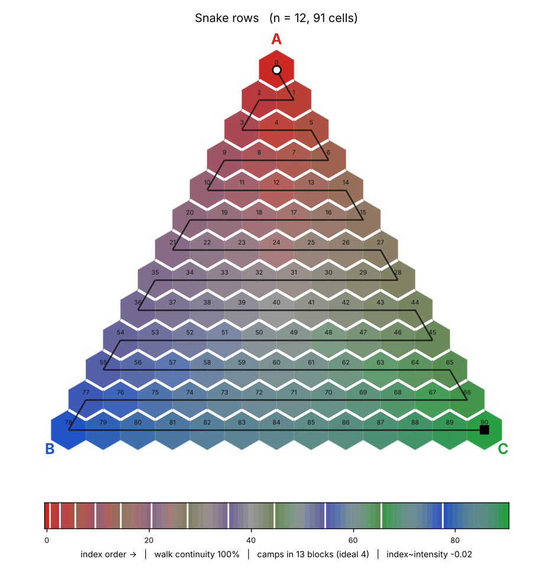

**Idea/Pros**: Fixes the line-break jump. Read alternate rows in opposite directions (left to right, then right to left), like an ox plowing a field. This is called *boustrophedon* order. The last cell of one row sits right next to the first cell of the next row when you reverse direction. Checked in the tests for every `n` from 1 to 40: **every step is to a neighbor** (R2 holds).

**Cons** Exactly what broke before, minus the jumps. The walk still sweeps the whole width every row, so the index line is still a rainbow (R3 fails) and still says nothing about distance from the center (R4 fails). Continuity alone does not produce meaning.

### 6.3 Corner clusters

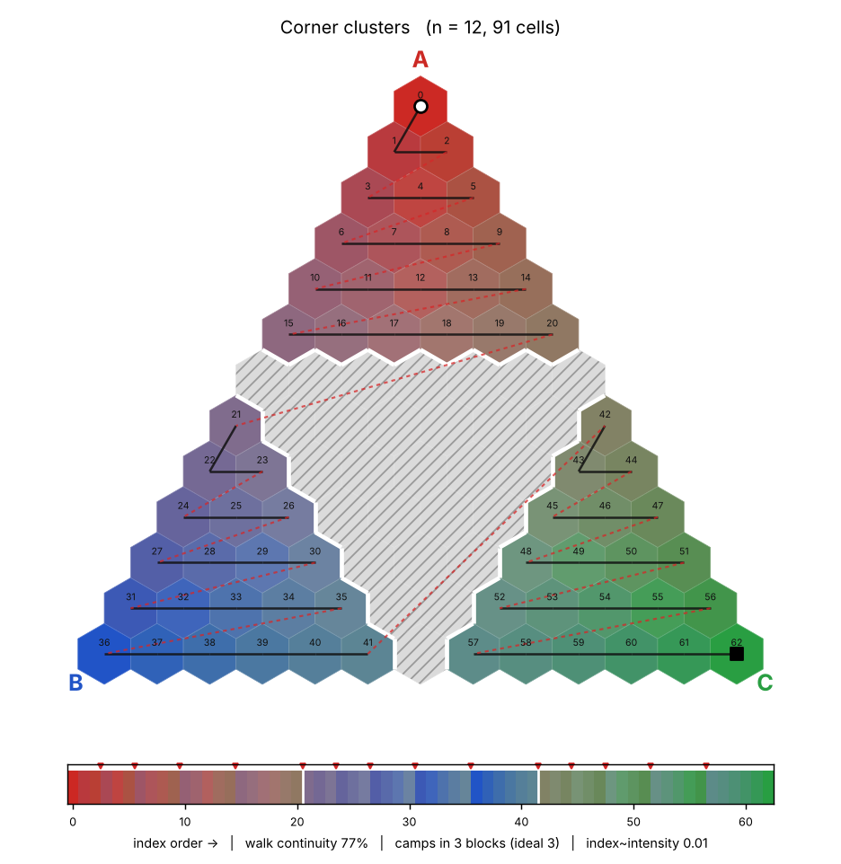

**Idea/Pros**:  Groups by corner the direct way. If the goal is "nearby numbers belong to the same corner", number each corner separately: all cells with more than 50 % A first, then all cells with more than 50 % B, then C. Each corner is one block of indices (R3 holds for the indexed cells).

**Cons**
- The middle of the triangle, where no share exceeds the threshold, gets **no index at all** (hatched). At 50 % that is between a fifth and a third of all cells depending on `n`, and they are precisely the balanced mixes one usually most wants to describe (R1 fails).
- Inside each cluster the order is still raster, with jumps (R2 fails).
- Raising the threshold makes the hole bigger; lowering it below ⅓ makes clusters overlap. There is no setting that covers everything.

### 6.4 Interlude

Something at this point becomes clear from the last three methods. **There is no continuous one-to-one correspondence between a two-dimensional region and a line.** (Often called *Netto's theorem*) you can map a line onto a square continuously (space-filling curves do it), and you can map a square onto a line one-to-one (by interleaving digits), but never both at once. On a finite grid this shows up as tearing: **whatever order you choose, some pairs of neighboring cells must end up far apart in index.**

So the question is never "how do we avoid tearing?" but "where do we put the tears, and what does the number mean in between?" This is what is attempted next.

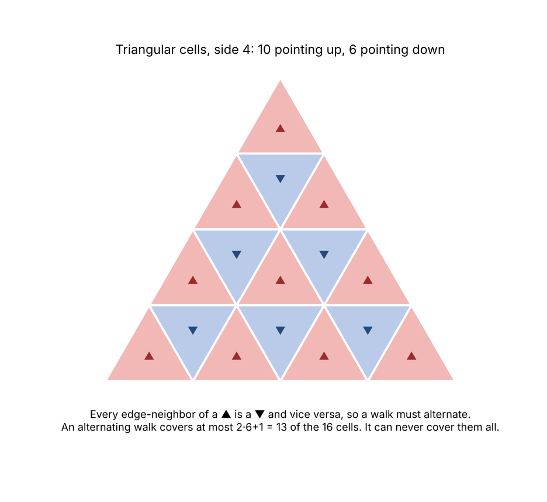

A natural first instinct is to chop the triangle into small **triangles** (the familiar "triforce" subdivision). It turns out that **no walk can visit every small triangle exactly once while always crossing a shared edge.** The proof fits in two lines:

- Small triangles come in two orientations, ▲ and ▼. Every edge-neighbor of a ▲ is a ▼ and vice versa, so any walk must alternate ▲ ▼ ▲ ▼...
- A side-`n` triangle contains `n(n+1)/2` ▲ cells but only `n(n−1)/2` ▼ cells: `n` more ▲ than ▼. An alternating walk can include at most one more ▲ than ▼, so it covers at most `2·(n(n−1)/2) + 1` cells, which is fewer than all of them for every `n ≥ 2`.

The fix is to use the **lattice points** themselves as cells, drawn as hexagons. Each has up to six neighbors in three directions, the up/down parity disappears, and walks become possible. Every scheme in this repository uses hexagonal cells for this reason.

### 6.5 Recursive (fractal) walk, starting from corner

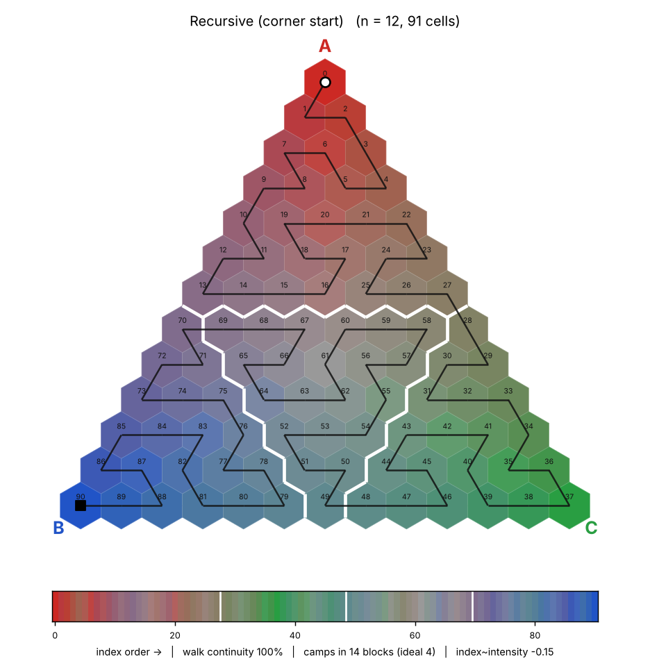

**Idea**: Borrow the trick behind space-filling curves: split the triangle into four smaller triangles (three corner triangles and an upside-down middle one), decide an order to visit the four pieces, then apply the same rule inside each piece, and inside each piece's pieces, all the way down to single cells. Each piece then forms one unbroken block of indices *at every scale*, so the index behaves like a nested address: the first part says which quarter, the next which quarter of that quarter, and so on.

With a **small-triangle** subdivision, the three corner pieces touch each other only at single points, never along an edge. The only piece touching all the others is the middle one. A walk would have to go corner → middle → corner and then be stuck, because the third corner touches nothing unvisited except the middle. The left half of this figure shows this "star" problem:

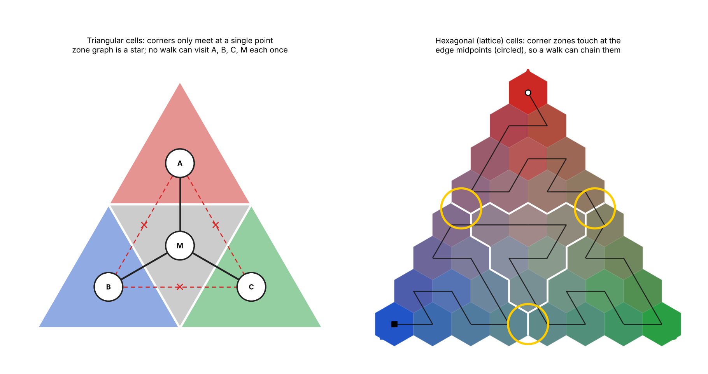

With **hexagonal** lattice cells, corner pieces do touch each other: at each edge midpoint there is exactly one pair of neighboring cells, one from each corner piece (circled on the right). That single contact is enough to chain corners together.

Using the function `corner_path_local` we build a walk that enters a triangle at corner X and leaves at corner Y, covering every cell:

1. Visit the **X-corner piece**, entering at X and leaving at its corner cell that touches the Z-corner piece (the contact near the X–Z midpoint).
2. Visit the **Z-corner piece**, leaving at its cell touching the middle piece.
3. Visit the **middle piece** corner to corner, leaving at the cell that touches the Y-corner piece.
4. Visit the **Y-corner piece**, ending at Y.

Each piece's own walk is again "enter at one corner, leave at another", so the same function is used recursively. Coordinates are kept in exact integer arithmetic throughout: a cell `(u, v, t)` of a side-`k` piece whose corners are the parent's lattice points `P, Q, R` maps to `(u·P + v·Q + t·R) / k`.

A side-`s` triangle splits cleanly only when `s` is odd:

| Side `s` | Corner pieces | Middle piece |
|---|---|---|
| `2m + 1` (odd) | three of side `m` | upside-down, side `m − 1` |
| `2m` (even) | one of side `m` (the one you start in), two of side `m − 1` | upside-down, side `m − 1` |

The even cut gives the entry corner the extra row so that the contacts still line up. With both rules the recursion works for every `n`, which the tests verify for `n = 1 … 40`, along with the claim that every piece at every depth forms one unbroken block.

**Pros**: Full coverage (R1). No jumps at all (R2). Its own four quadrants, and their sub-quadrants, each form one block (R3 for *its* zones).

**Cons**:
- Its zones are not the camps. The corner pieces are triangles, while the regions where one share is largest are kites. A point at 45 % A, 45 % B, 10 % C is in neither "corner" piece; it sits in the middle piece. So scored against the camps, the walk breaks them into 14 to 18 blocks instead of 4 (R3 fails for the camps).
- Within a piece, the walk snakes in and out, so the index goes up and down in distance from the center (R4 fails; see [6.9](#69-the-real-conflict-direction-versus-magnitude)).
- Its worst tear is large (about 63 % of the index range at `n = 21`): cells on either side of the seam between the first and last pieces are far apart. That is the price of grouping.

### 6.6 Recursive (fractal) walk, starting at the center

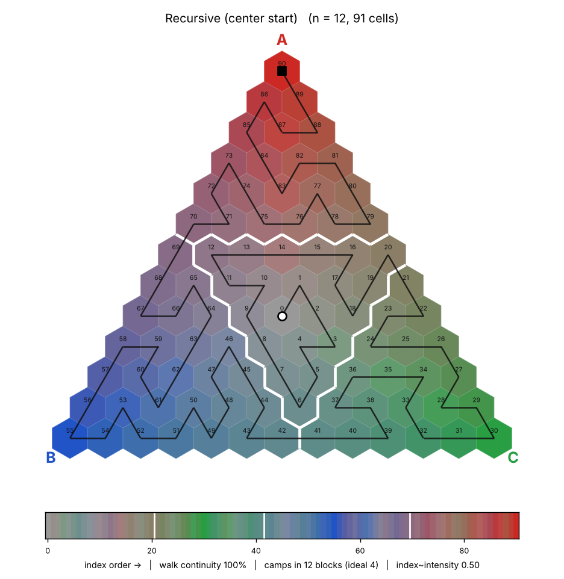

**Idea**: If index 0 should mean "perfectly balanced" (R5), start the walk at the center instead of a corner.

Using function `center_path_local` you visit the **middle piece first**, using the same center-start rule inside it, so the walk begins at the innermost cell. Then visit the three corner pieces, chained through their single-cell contacts, ending at a chosen apex. Concretely: middle (starting at its own center) → Z-corner → Y-corner → X-corner, ending at apex X.

The middle piece can be placed in two mirror-image orientations that both connect correctly to the next piece. The code tries both at every level and keeps the one whose first cell lands closest to the true centroid. For `n = 3, 9, 12, 21, 24, 27` (and others) index 0 lands exactly on the centroid cell. For some sizes (for example `n = 6, 15, 30`) the geometry of the nested cuts makes that impossible and index 0 sits one cell away (at most two cells, checked for all `n ≤ 40`).

**Pros**: Everything 6.6 gets right, plus R5. Because the walk works outward, the index correlates noticeably better with distance from the center (Spearman ≈ +0.5 against ≈ −0.15 for the corner-start version).

**Cons**: The same things as 6.6: camps are fragmented, and inside each piece the walk still swings in and out.

### 6.7 Ring spiral

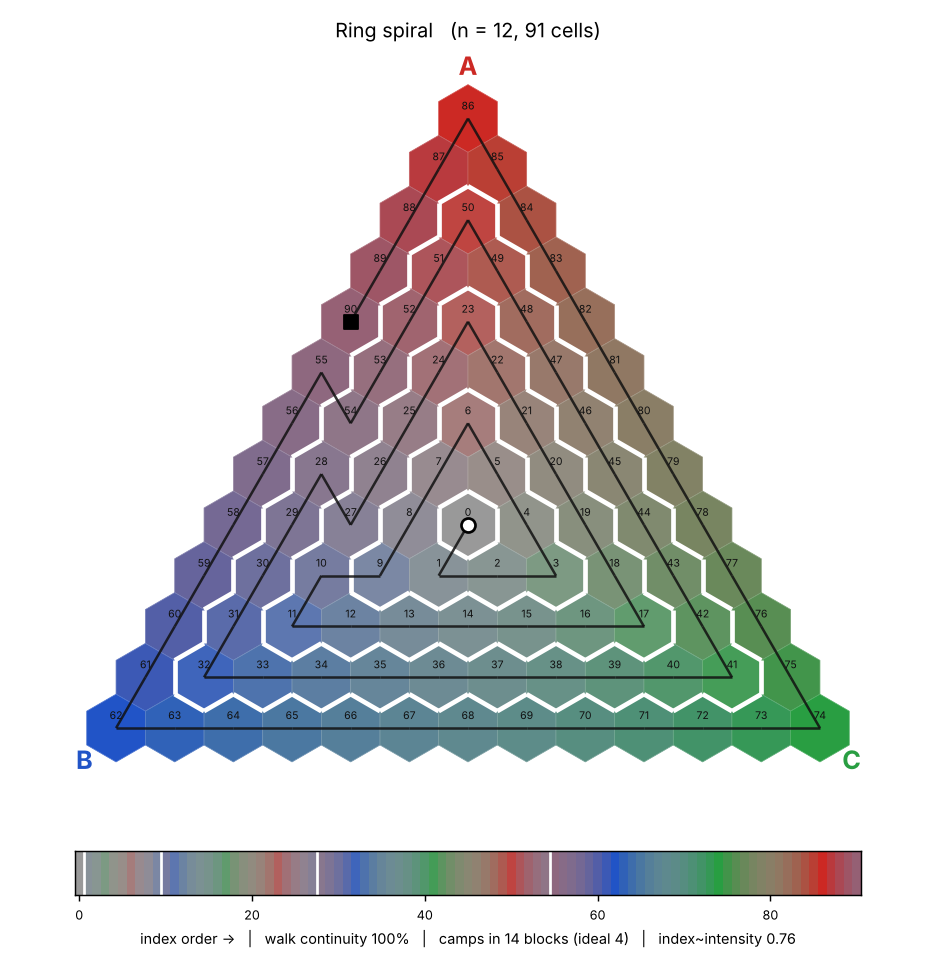

**Idea**: If the number should mean "distance from the center" (R4), visit the cells in concentric rings: the innermost ring first, then the next one out, and so on. Ring `k` is the set of cells whose *smallest* share equals `k`. Each ring is the outline of a smaller triangle. Walk each outline counter-clockwise, and start each new ring on a cell next to where the previous ring ended. Every cell on a ring has a neighbor on the next ring out, so this always connects: an unbroken spiral (verified for `n = 1 … 40`).

**Pros**: Full coverage, no jumps, starts at the center, and the index rises with distance from the center far more faithfully than any other walk (Spearman ≈ +0.8 within camps).

**Cons**: Every ring passes through all three corners' colors. Index 100 and index 101 can be on the same ring but in different camps, and every camp is split into one block per ring (R3 fails badly). It is the mirror image of the corner-grouping schemes: it tracks *how far* and forgets *which way*.

### 6.8 Direction versus magnitude

Look again at the cell colors in any figure. Two things vary independently across the triangle:

- **Direction**, shown as hue: which corner (or which pair of corners) the point leans toward.
- **Magnitude**, shown as saturation: how far the point is from the grey center.

A walk is one-dimensional: as the index counts up, it can make *one* quantity change smoothly. It can follow direction (sweep corner by corner, like the recursive walks) or follow magnitude (sweep ring by ring, like the spiral), but not both. Whichever it does not follow, it must cycle back and forth through. **No walk can make "same camp" and "further out" both align with "higher index".** No more clever curve exists here - a smooth sequence through the triangle that is grouped by camp must leave each camp's region and come back to the center at some point, and while it does so its distance from the center goes down even though the index goes up. Aka that aspect of the design is muddied.

The difference is easiest to see with a moving point. Here one agent takes 28 actions (five toward A, three balancing, six toward B, three toward an A/B mix, seven toward C, four balancing), and the plots show what four schemes' indices do along the way:

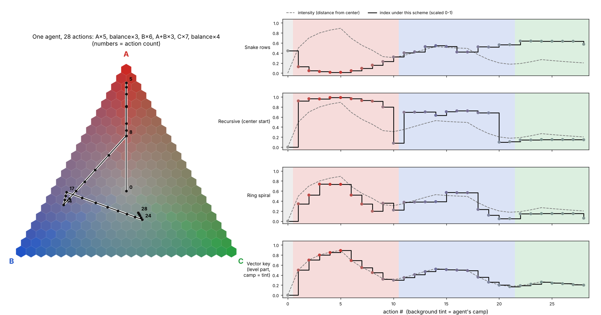

- **Snake rows**: the index drifts in ways unrelated to either camp or distance.
- **Recursive (center start)**: the first action sends the index from 0 almost to the top of its range; later (action 10) the index drops off a cliff while the point barely moves, because it crossed a zone seam.
- **Ring spiral**: the index tracks the dashed distance curve fairly well, but it cannot tell the A-phase from the B-phase; the camp changes (background tint) leave no mark.
- **Vector key** (the approach in the next section): the camp is carried separately (the tint, or the leading digit of the key), and the rest of the key follows the distance curve exactly.

---

## 7. Resolution: store the point, derive the index

Since no single walk can carry both pieces of information, we abandon the idea of the walk method of indexing. Instead:

> **Store the point itself. Compute everything else from it, whenever you need it.**
> This leaves behind the need to design a cell lattice that follows a local directional tie-in

### 7.1 The stored state

Exactly two things:

- the triplet `w = (A, B, C)`, three numbers that add up to 1,
- how many actions have been applied so far (needed only by the update rule in [section 8](#8-moving-the-point-the-update-rule)).

Everything below is a pure function of `w`, implemented in [`ternary_index/geometry.py`](ternary_index/geometry.py) and mirrored in [`unity/TernaryState.cs`](unity/TernaryState.cs). Nothing derived is ever stored, so nothing can get out of sync.

### 7.2 Camps: a neutral disc and three kites

Draw straight lines from the centroid to the three edge midpoints to symbolize boundaries between the three apex quantities/qualities at the vertices. They cut the triangle into three four-sided **kites**. Inside corner X's kite, X is the largest share, so membership is just:

```
camp = the corner with the largest share        (ties go to the earlier letter)
```

Then carve out a small **neutral** disc around the center: any point whose intensity (7.3) is below an assigned `neutral_radius` (default 0.15) is neutral, whatever its largest share. Neutral can be considered a real camp, not an absence of one of the other three - a balanced point is a meaningful state, though this does not necessarily have to mean anything other than that.

### 7.3 Magnitude: how far from the center

There are two sensible ways to measure distance from the center, and they disagree near the edge midpoints. Both are available everywhere in the code (`metric="euclidean"` or `metric="edge"`).

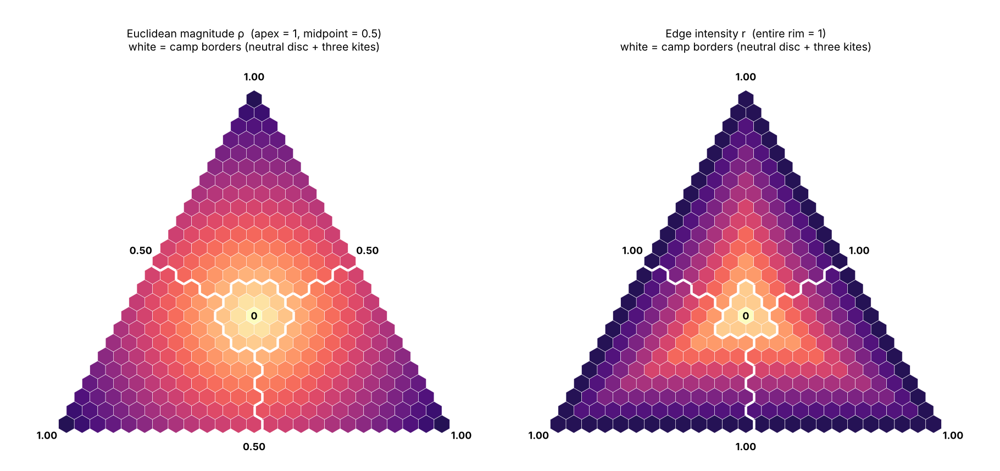

**Euclidean magnitude ρ** (the default) is the actual straight-line distance from the centroid, scaled so that each apex is exactly 1:

```
ρ(w) = sqrt( 1.5 × [ (A − ⅓)² + (B − ⅓)² + (C − ⅓)² ] )
```

Where the 1.5 comes from: at an apex such as `(1, 0, 0)` the bracket equals `(⅔)² + (⅓)² + (⅓)² = ⅔`, and `1.5 × ⅔ = 1`. The edge midpoints are only half as far from the centroid as the apexes, so they score 0.5. Under this measure **only the pure apexes are fully extreme**; a 50/50 two-way mix is half-way out.

**Edge intensity r** is 1 everywhere on the outer edge:

```
r(w) = 1 − 3 × min(A, B, C)
```

Along the ray from the centroid through `w`, the smallest share is the first to reach zero, so `r` is the fraction of that ray already covered. Under this measure **every point on the rim is fully extreme**, including 50/50 mixes. Desirable sometimes, but is in disagreement with the vertices being the apex states.

On the straight line from the center to an apex the two agree exactly. They differ most at the edge midpoints:

| Point | ρ (Euclidean) | r (edge) | Camp | Lean |
|---|---|---|---|---|
| centroid `(⅓, ⅓, ⅓)` | 0.000 | 0.000 | neutral | n/a |
| `(0.40, 0.35, 0.25)` | 0.132 | 0.250 | neutral (ρ) / A (r) | 0.67 |
| `(0.50, 0.25, 0.25)` | 0.250 | 0.250 | A | 0.00 |
| `(0.60, 0.20, 0.20)` | 0.400 | 0.400 | A | 0.00 |
| `(0.45, 0.45, 0.10)` | 0.350 | 0.700 | A (tie) | 1.00 |
| edge midpoint `(0.5, 0.5, 0)` | 0.500 | 1.000 | A (tie) | 1.00 |
| `(0.70, 0.30, 0)` | 0.608 | 1.000 | A | 0.43 |
| `(0.90, 0.05, 0.05)` | 0.850 | 0.850 | A | 0.00 |
| apex `(1, 0, 0)` | 1.000 | 1.000 | A | 0.00 |

Which to use depends on what "extreme" should mean in your application. If only a near-pure mix should count as extreme, use ρ. If any mix that has dropped one quantity entirely should count, use r.

### 7.4 Lean: which neighbor a point tilts toward

Inside a kite, points can sit right on the line to the apex or drift toward the border with a neighboring kite. That is captured by:

```
lean = (second largest − smallest) / (largest − smallest)
```

- `lean = 0`: the two smaller shares are equal; the point aims straight at its apex.
- `lean = 1`: the two larger shares are equal; the point is on the border between two kites.
- The neighbor it leans toward is the corner with the second-largest share.

Lean is how two-way blends are described without inventing more camps: "in A's camp, leaning 0.8 toward B" is a strong A/B blend. No trigonometry is needed.

### 7.5 The key: one integer, when you still want one

If a single integer is still useful (for a lookup table, for sorting, for storage), build it from the derived quantities instead of from a walk:

```
key = camp × 100 + min(99, floor(100 × intensity))
```

with camp 0 = neutral, 1 = A, 2 = B, 3 = C.

| Point | Euclidean key | Edge key |
|---|---|---|
| centroid | 0 | 0 |
| `(0.50, 0.25, 0.25)` | 125 | 125 |
| `(0.60, 0.20, 0.20)` | 140 | 140 |
| edge midpoint `(0.5, 0.5, 0)` | 150 | 199 |
| `(0.90, 0.05, 0.05)` | 185 | 185 |
| apex `(1, 0, 0)` | 199 | 199 |

Properties:

- **Same camp, same hundreds digit.** 190 and 191 are always in the same camp (R3, perfectly: 4 blocks for 4 camps).
- **Within a camp, the key rises monotonically with distance from the center** (R4, perfectly: rank correlation 1.00).
- **Neutral is 0–99, starting at 0 at the center** (R5).
- **Small moves give small changes in the last two digits**, unless the move crosses a camp border, in which case the hundreds digit changes. That is a meaningful change, not an artifact (R6).
- Every cell, and in fact every continuous point, has a key (R1).

As mentioned in 7.3, this is not a walk (R2 does not apply). Key 140 and key 141 can be on opposite sides of a kite, at the same distance from the center, but they really are equally intense members of the same camp. If you also need the side, add the lean as a second key.

The band width 100 is arbitrary here as well; use 1000 for finer intensity levels (`band=` parameter, `Band` field in C#). Exact band edges are protected against floating-point rounding with a tiny epsilon in both implementations.

### 7.6 The color map used in the figures

The figures color each point with a **radial** fade so that the picture shows both direction and magnitude:

1. Find where the ray from the centroid through the point meets the outer edge. The hue there is a straight blend of the two corner colors on that edge: pure at an apex, 50/50 at a midpoint.
2. Fade from neutral grey at the center to that hue, in proportion to the chosen intensity (ρ or r).

With ρ, the edge midpoints are half-saturated; with r, the whole rim is fully saturated. Switch between them in the demo to see the difference.

---

## 8. Moving the point: the update rule

If the point represents something that changes (a running mix, a profile built from choices, a portfolio drifting between three assets), it needs an update rule. The one used here, in [`ternary_index/state.py`](ternary_index/state.py) and the C# class, is:

```
w  ←  w + α × (target − w)
α  =  min(1, step / (seed + actions + 1))
```

Each action names a **target** somewhere in the triangle and pulls the point part of the way there:

| Action | Target |
|---|---|
| pure action toward a corner | that apex, e.g. `(1, 0, 0)` |
| blended action | any mix, e.g. `(½, ½, 0)` for an even A/B blend, or `(2, 1, 0)` normalized |
| balancing action | the centroid `(⅓, ⅓, ⅓)` |
| bigger or smaller action | the same target with a `weight` multiplier on `α` for that one action |

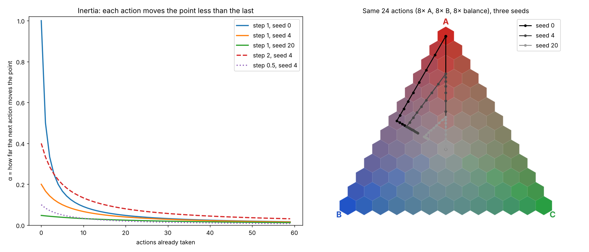

**Benefits to this rule**:

- **It can never leave the triangle.** The new point is a weighted average of two points inside the triangle, and a triangle is convex, so the result is inside too. No clamping or rescaling is ever needed. (The code still renormalizes to guard against floating-point drift.)
- **Inertia.** `α` shrinks as actions accumulate, so early actions move the point a lot and late actions move it a little. After many actions, a long history is hard to overturn. This is the left-hand plot.
- **Tallying.** With `step = 1`: pretend you start with `seed` imaginary actions split evenly between the three corners, count one more for each real action toward its target, and divide by the total. Proof: if the counts are `c` and the total is `N = seed + actions`, then `w = c / N`. One more action toward `t` gives `(c + t) / (N + 1) = w + (t − w) / (N + 1)`, which is the rule with `α = 1 / (N + 1)`. So you can reason about it either way.
- **`seed` sets early volatility.** `seed = 0` makes the very first action jump all the way to its target. A large seed makes the early game sluggish. Right-hand plot: the same 24 actions with seeds 0, 4 and 20.
- **`step` scales everything.** Above 1, the point stays more responsive for longer; below 1, it is more stubborn from the start.
- **Neutrality is an action, not an absence.** Balancing pulls toward the center through the same formula. A point can be *moved* back to neutral deliberately, and late in a long history that takes as much sustained effort as moving anywhere else, which is usually the desired behavior.
- **Camp changes are events.** Both implementations fire a callback/event with the old and new camp whenever an action moves the point across a camp border, so anything that should react to a change of camp (as opposed to the point simply drifting) has a single, reliable hook.

---

## 9. The scorecard

Every scheme is measured by [`ternary_index/metrics.py`](ternary_index/metrics.py), against camps with a neutral radius of 0.15 and Euclidean intensity.

| Score | Definition | Ideal |
|---|---|---|
| **Coverage** | Fraction of cells that get an index. | 100 % |
| **Walk continuity** | For walks: fraction of steps `k → k+1` between neighboring cells. "Not a walk" for the vector key. | 100 % |
| **Mean / max tear** | Over every pair of neighboring cells, the index difference as a fraction of the full index range. Mean and worst. | low (but see [6.4](#64-interlude-why-no-index-can-ever-be-perfect): the max can never be 0) |
| **Own zones in blocks** | Walk through cells in index order and count unbroken runs of the scheme's *own* zones. Shows whether a scheme keeps its own promise. | = number of zones |
| **Camps in blocks** | Same, counting runs of the *camps* (neutral disc + three kites). | = number of camps (4) |
| **Same-camp next index** | Fraction of consecutive indices that stay in the same camp ("are 90 and 91 in the same camp?"). | 100 % (minus the unavoidable camp boundaries) |
| **Index~intensity rank** | Spearman rank correlation between index and intensity inside each camp, weighted by camp size. | +1.00 |

**n = 12 (91 cells)**

| Scheme | Coverage | Walk continuity | Mean / max tear | Own zones in blocks | Camps in blocks | Same-camp next index | Index~intensity rank |
|---|---|---|---|---|---|---|---|
| Raster rows | 100% | 88% | 0.069 / 0.144 | 13 (ideal 13) | 18 (ideal 4) | 81.1% | −0.01 |
| Snake rows | 100% | 100% | 0.069 / 0.267 | 13 (ideal 13) | 13 (ideal 4) | 86.7% | −0.02 |
| Corner clusters | 69% | 77% | 0.050 / 0.097 | 3 (ideal 3) | 3 (ideal 3) | 96.8% | +0.01 |
| Recursive (corner start) | 100% | 100% | 0.077 / 0.633 | 4 (ideal 4) | 14 (ideal 4) | 85.6% | −0.15 |
| Recursive (center start) | 100% | 100% | 0.101 / 0.700 | 4 (ideal 4) | 12 (ideal 4) | 87.8% | +0.50 |
| Ring spiral | 100% | 100% | 0.161 / 0.422 | 5 (ideal 5) | 14 (ideal 4) | 85.6% | +0.76 |
| **Vector key** | **100%** | not a walk | 0.077 / 0.787 | 4 (ideal 4) | **4 (ideal 4)** | **96.7%** | **+1.00** |

**n = 21 (253 cells)**

| Scheme | Coverage | Walk continuity | Mean / max tear | Own zones in blocks | Camps in blocks | Same-camp next index | Index~intensity rank |
|---|---|---|---|---|---|---|---|
| Raster rows | 100% | 92% | 0.041 / 0.087 | 22 (ideal 22) | 31 (ideal 4) | 88.1% | +0.03 |
| Snake rows | 100% | 100% | 0.041 / 0.167 | 22 (ideal 22) | 21 (ideal 4) | 92.1% | +0.03 |
| Corner clusters | 78% | 85% | 0.028 / 0.340 | 3 (ideal 3) | 3 (ideal 3) | 99.0% | +0.02 |
| Recursive (corner start) | 100% | 100% | 0.047 / 0.631 | 4 (ideal 4) | 18 (ideal 4) | 93.3% | −0.14 |
| Recursive (center start) | 100% | 100% | 0.062 / 0.782 | 4 (ideal 4) | 19 (ideal 4) | 92.9% | +0.53 |
| Ring spiral | 100% | 100% | 0.104 / 0.258 | 8 (ideal 8) | 22 (ideal 4) | 91.7% | +0.80 |
| **Vector key** | **100%** | not a walk | 0.047 / 0.772 | 4 (ideal 4) | **4 (ideal 4)** | **98.8%** | **+1.00** |

**How to read the tables.**

- Every *walk* keeps its own promise (own zones = ideal, continuity 100 %), and none of them groups by camp *and* tracks intensity.
- Corner clusters groups by camp only because it refuses to index the middle.
- The ring spiral is the best walk at tracking intensity and among the worst at grouping by camp. The recursive walks are the reverse, relative to their own quadrants.
- The vector key is the only scheme with perfect camp grouping *and* perfect intensity ranking. Its max tear is large because a camp border is a seam by design: crossing from A's kite into B's kite changes the hundreds digit. That is the tear placed exactly where it carries meaning.
- The tables are regenerated by `python scripts/render_figures.py` (written to `figures/results.md`).

---

## 10. Further reading

- [Ternary plot](https://en.wikipedia.org/wiki/Ternary_plot): how the three shares map onto a triangle.
- [Barycentric coordinate system](https://en.wikipedia.org/wiki/Barycentric_coordinate_system): the general idea behind the triplet.
- [Space-filling curve](https://en.wikipedia.org/wiki/Space-filling_curve) and [Hilbert curve](https://en.wikipedia.org/wiki/Hilbert_curve): the family the recursive walks belong to, and why they keep locality only one way.
- [Hamiltonian path](https://en.wikipedia.org/wiki/Hamiltonian_path): the graph-theory name for "a walk that visits every cell exactly once".
- [Boustrophedon](https://en.wikipedia.org/wiki/Boustrophedon): the snake-row reading order.

---
